# GeoTactical Telemetry Monitor 🛰️🌾

<div align="center">

[](https://github.com/mserman90/GeoTactical/actions/workflows/deploy.yml)
[](https://mserman90.github.io/GeoTactical/)
[](LICENSE)
[](https://react.dev/)
[](https://www.typescriptlang.org/)
[](https://vitejs.dev/)
[](https://maplibre.org/)
[](https://github.com/mserman90/GeoTactical)

**Tactical Geospatial Surveillance & Precision Agri-Telemetry Console**  
*An autonomous situational awareness dashboard fusing military-grade HUD aesthetics with precision agricultural telemetry, real-time UAV/tractor kinematic tracking, IoT soil probe grids, simulated Doppler meteorology, and a 100% keyless AI copilot.*

[🚀 **Launch Live Telemetry Console**](https://mserman90.github.io/GeoTactical/) • [📖 Documentation](#-core-capabilities) • [🇹🇷 Türkçe Dokümantasyon](#-türkçe-proje-açıklaması)

</div>

---

## 📌 Overview

**GeoTactical** is an open-source tactical command-and-control (C2) console engineered for modern smart agriculture and geospatial telemetry monitoring. It combines defense-inspired Head-Up Display (HUD) aesthetics with precision agricultural operations, empowering operators to track autonomous drone sweeps, soil moisture anomalies, tractor plowing routes, and localized Doppler storm fronts in real time across multiple global farming corridors.

The platform is built from the ground up to be **100% free, open-source, and completely keyless** — requiring **zero API keys, zero tokens, zero accounts, and zero paid service tiers**.

---

## ⚡ Core Capabilities

### 🗺️ 1. 100% Free & Keyless Multi-Basemap GIS
Powered by **MapLibre GL v6**, the console provides instant switching between 4 distinct, open, and keyless base layers with zero watermarks or rate limits:
- **Tactical Dark (`DARK`):** OpenFreeMap Dark Vector (`tiles.openfreemap.org`) — Native high-DPI vector map styled for military-grade night operations, high-contrast reticle overlays, and radar sweeps. Replaces proprietary or key-restricted providers (like Carto) with a truly open-source solution.
- **Satellite Recon (`SATELLITE`):** ESRI World Imagery — High-resolution aerial photographic reconnaissance for crop canopy health and field perimeter inspection.
- **Terrain Topo (`TOPO`):** ESRI World Topo — Shaded relief and elevation contours essential for drainage slope, watershed, and runoff risk evaluation.
- **OpenStreetMap (`OSM`):** Community-driven global cartography with complete roadway, parcel, and infrastructure networks.

### 🤖 2. Zero-Key Tactical AI Copilot (ARES-AGRI)
Accessible via the header's **AI COPILOT** terminal, this dual-engine agricultural advisor assists operators with anomaly detection and automated mission dispatch without demanding any Gemini or OpenAI tokens:
- **Primary Neural Model:** Direct browser-to-API inference via `Pollinations.ai` (zero-auth, keyless, CORS-enabled). Formats rapid agronomic assessments based on live soil moisture, drone telemetry, and regional weather.
- **Autonomous Local Rule Engine:** Operates instantly when offline or in bandwidth-constrained environments, identifying drought hotspots and proposing executable single-click actions (e.g., drip line valve activation or UAV Return-to-Home).

### 🛰️ 3. Kinematic Fleet Tracking & Target Locking
- **Real-Time Kinematic (RTK) Precision:** Tracks UAV reconnaissance drones, autonomous field tractors, static IoT soil probes, and valve actuators with sub-meter simulation accuracy.
- **Chase Cam Mode:** Smoothly locks the 3D perspective camera onto any moving asset to track its live flight or cultivation corridor.
- **Live Flight Trails:** Glowing vector breadcrumbs displaying historical trajectory, altitude, ground speed, and heading.

### 📍 4. Interactive Waypoint Mission Planner
- **Click-to-Draw Flight Corridors:** Click directly on the map to plot mission waypoints for active UAVs.
- **Geodesic Telemetry Calculation:** Real-time distance and flight time calculations using the Haversine formula based on cruising speed.
- **Instant Deployment:** Dispatches the drafted route directly to the drone flight computer with simulated voice confirmation.

### 🌧️ 5. Doppler Meteorology & Wind Vector Simulation
- **Animated Doppler Precipitation Heatmap:** Dynamically simulated rain cells ranging from light drizzle (5 mm/h) to severe storm fronts (45+ mm/h).
- **Wind Speed Velocity Heatmap:** Real-time atmospheric velocity modeling with particle vectors showing storm heading and peak gusts.

### 🔊 6. Synthesized Audio Engine & Tactical Voice Annunciator
- **Zero-File Web Audio Synthesizer:** Pure mathematical sound synthesis using native HTML5 `OscillatorNode` and `GainNode` for radar pings, button clicks, and target acquisition beeps without downloading audio assets.
- **Synthetic Voice Annunciator:** Uses the browser's native `window.speechSynthesis` (Web Speech API) to speak mission alerts, RTH commands, and drought warnings in a military radio style.

### 📦 7. Standard GeoJSON Parcel Boundaries & Export
- Field parcels are color-coded by hydration stress (Optimal, Moderate, Critical).
- Single-click export of current sector boundaries and telemetry attributes to standard `.geojson` files for GIS software (QGIS, ArcGIS, Blender GIS).

### 🌋 8. Live AFAD & Kandilli Seismic Telemetry Grid (Zero-Key & Real-Time)
- **Official AFAD Event Service & Kandilli Observatory Ingestion:** Ingests live seismic tremor telemetry across Turkey, the Aegean Sea, and the Eastern Mediterranean without requiring any token or account.
- **Dual-Tier Zero-Auth Architecture:** Leverages direct EMSC FDSNWS GeoJSON feeds (ingesting official AFAD data under `auth: "AFAD"`) paired with Kandilli real-time district feeds to provide high-precision Turkish district/provincial names with zero CORS blocking.
- **Tactical Seismic HUD & Dynamic Ripple Circles:** Visualizes tremors on the tactical map canvas with magnitude-scaled pulsing shockwaves (green for micro-tremors, orange for M3+, and deep crimson for M4+ events).
- **Subterranean Acoustic Resonance:** Synthesizes low-frequency seismic rumbling tones using the Web Audio API when tremors above M3.5 are detected.
- **Instant Epicenter UAV Reconnaissance:** Click any tremor on the map or in the HUD to lock the camera on the epicenter, inspect focal depth/MMI intensity, and dispatch an active UAV on a reconnaissance vector.

---

## 🌍 Supported Agricultural Corridors

GeoTactical features pre-configured regional corridors with localized crops, soil profiles, and simulated telemetry:

| Region | Location | Key Crops & Features | Primary Hazards Monitored |
| :--- | :--- | :--- | :--- |
| **Aegean Agri-Corridor** | Gediz Basin, Turkey 🇹🇷 | Durum wheat, Ayvalık olive groves, Sultana vineyards, hybrid tomatoes | High transpiration, soil drought, high summer temperatures |
| **San Joaquin Valley** | California, USA 🇺🇸 | Almond orchards, pistachio groves, pivot-irrigated alfalfa | Water table depletion, extreme evaporation, high wind gusts |
| **Rhine Valley Terraces** | Rhineland, Germany 🇩🇪 | Steep-slope Riesling vineyards, Pinot Noir, Black Forest hops | Erosion on steep inclines, excessive rainfall, localized hail |

---

## 🏗️ Architecture

```mermaid
graph TD
    subgraph UI ["User Interface Layer"]
        Header["Header: Clock, Basemap Selector, Sound, Fullscreen, AI Trigger"]
        LeftSidebar["LeftSidebar: Target Roster, Layer Toggles, Region Presets"]
        MapView["MapView: MapLibre Canvas, Reticle HUD, Weather HUD, Map Controls"]
        RightSidebar["RightSidebar: Asset Inspection, Telemetry Metrics, Event Stream, GeoJSON Export"]
        BottomBar["BottomBar: Feed Controls, Latency, GNSS Satellites, Security Status"]
        AiModal["TacticalAiModal: Keyless Neural Copilot & Fast Diagnostic Prompts"]
    end

    subgraph MapModules ["MapLibre Modular Components"]
        MapControls["MapControls: Zoom, Bearing, 3D, WGS-84 & Basemap Badge"]
        TacticalHud["TacticalHudOverlay: 360° Radar Sweep, HUD Reticle Brackets"]
        WeatherHud["WeatherTelemetryHud: Doppler/Wind Mode, Dynamic Heatmap Ramp"]
        WaypointHud["WaypointPlannerHud: Interactive Distance & Flight Time Calculator"]
        useAssetMarkers["useAssetMarkers: DOM Marker Lifecycle & Category Filter"]
        useMapLayers["useMapLayers: Sector Polygons, Flight Trails, Weather Heatmaps"]
        mapStyles["mapStyles: OpenFreeMap Dark, ESRI Satellite, ESRI Topo, OSM"]
    end

    subgraph StateLogic ["State, Telemetry & Audio Engine"]
        App["App: Central State, Simulation Clock, Regional Dispatcher"]
        MockData["mockData: Multi-Region Telemetry Datasets"]
        WeatherData["weatherData: Gaussian Storm Cell & Velocity Vector Field Generator"]
        Audio["audio: Web Audio API Synthesizer & Speech Annunciator"]
        AiService["aiService: Pollinations.ai Neural Client + Offline Fallback Engine"]
    end

    App --> Header
    App --> LeftSidebar
    App --> MapView
    App --> RightSidebar
    App --> BottomBar
    App --> AiModal

    MapView --> MapControls
    MapView --> TacticalHud
    MapView --> WeatherHud
    MapView --> WaypointHud
    MapView --> useAssetMarkers
    MapView --> useMapLayers
    mapStyles --> MapView

    MockData --> App
    WeatherData --> useMapLayers
    Audio --> UI
    AiService --> AiModal
```



---

## 📂 Project Directory Structure

```text
GeoTactical/
├── .github/
│   └── workflows/
│       └── deploy.yml          # Automated CI/CD deployment to GitHub Pages
├── dist/                       # Production bundle (Vite chunked)
├── src/
│   ├── components/
│   │   ├── map/
│   │   │   ├── MapControls.tsx         # Zoom, bearing reset, 3D toggle, WGS-84 HUD
│   │   │   ├── mapStyles.ts            # OpenFreeMap, ESRI Satellite/Topo, OSM definitions
│   │   │   ├── TacticalHudOverlay.tsx  # 360° radar sweep and targeting reticle
│   │   │   ├── useAssetMarkers.ts      # Custom MapLibre DOM markers & filters
│   │   │   ├── useMapLayers.ts         # GeoJSON polygons, trails, weather heatmap sync
│   │   │   ├── WaypointPlannerHud.tsx  # Interactive route calculation HUD
│   │   │   └── WeatherTelemetryHud.tsx # Weather radar legend & peak cell telemetry
│   │   ├── BottomBar.tsx       # Live feed controls, latency, GNSS satellite status
│   │   ├── Header.tsx          # Real-time clock, basemap switcher, audio toggle
│   │   ├── LeftSidebar.tsx     # Tracked targets roster, layer visibility, regional presets
│   │   ├── MapView.tsx         # Core MapLibre container coordinating map submodules
│   │   ├── RightSidebar.tsx    # Selected node telemetry, sector metrics, log stream
│   │   └── TacticalAiModal.tsx # ARES-AGRI AI copilot interactive terminal
│   ├── data/
│   │   ├── mockData.ts         # Multi-region assets, sectors, waypoints, and presets
│   │   └── weatherData.ts      # Procedural Gaussian storm cell generator
│   ├── services/
│   │   └── aiService.ts        # Zero-key Pollinations.ai client & offline rule engine
│   ├── utils/
│   │   └── audio.ts            # Web Audio API synthesizer & Web Speech API annunciator
│   ├── App.tsx                 # Root application state & 2s telemetry simulation loop
│   ├── index.css               # Tactical glowing borders, radar sweeps, and scrollbars
│   ├── main.tsx                # React 19 entry point
│   └── types.ts                # TypeScript interfaces (Asset, Sector, MapStyle, Event)
├── .env.example                # Zero-key environment documentation
├── index.html                  # HTML5 entry with OpenGraph & tactical metadata
├── metadata.json               # Applet capabilities metadata
├── package.json                # Dependencies, scripts, and repository metadata
├── tsconfig.json               # TypeScript configuration
└── vite.config.ts              # Vite 6 config with vendor chunk splitting
```

---

## 🕹️ Operations & Controls Manual

| Control | Location | Function |
| :--- | :--- | :--- |
| **Basemap Selector** | Header (Right) | Toggle between `DARK` (OpenFreeMap), `SATELLITE` (ESRI), `TOPO` (ESRI Relief), and `OSM` (OpenStreetMap). |
| **AI Copilot** | Header (Right) | Opens the ARES-AGRI terminal for instant crop stress diagnostics and UAV action recommendations. |
| **Sound Toggle** | Header (Far Right) | Toggles Web Audio API radar sweeps and tactile click synthesis. |
| **Fullscreen** | Header (Far Right) | Expands the tactical console to edge-to-edge screen dimensions. |
| **Chase Cam** | Map Controls (Top-Right) | Smoothly locks the camera to follow the active drone or tractor as it moves across fields. |
| **Waypoint Planner** | Map Controls (Top-Right) | Activates crosshair cursor; click anywhere on the map to draft a flight route and deploy it to a UAV. |
| **3D Toggle** | Map Controls (Top-Right) | Toggles 3D pitch perspective (0° top-down vs. 55° tactical horizon). |
| **Compass** | Map Controls (Top-Right) | Smoothly re-centers map rotation to true North. |
| **Layer Toggles** | Left Sidebar | Selectively hide/show radar sweep, field boundaries, flight trails, HUD reticle, drones, tractors, or soil sensors. |
| **Regional Corridors**| Left Sidebar | Fly between Aegean (Turkey), San Joaquin (USA), and Rhine Valley (Germany). |
| **Export GeoJSON** | Right Sidebar | Downloads the current region's agricultural field boundaries as standard `.geojson`. |

---

## 🚀 Quick Start Guide

### Prerequisites
- [Node.js](https://nodejs.org/) v18+ (v20+ recommended)
- [npm](https://www.npmjs.com/) or [bun](https://bun.sh/)

### 1. Clone the Repository
```bash
git clone https://github.com/mserman90/GeoTactical.git
cd GeoTactical
```

### 2. Install Dependencies
```bash
npm install
```

### 3. Start Local Development Server
```bash
npm run dev
```
Open [http://localhost:3000](http://localhost:3000) in your browser. The console is fully operational with zero environment variable setup required!

### 4. Build for Production
```bash
npm run build
```
Generates optimized, vendor-chunked production files in the `dist/` directory:
- `vendor-maplibre`: MapLibre GL core (~286 kB gzip)
- `vendor-react`: React & React-DOM (~1.6 kB gzip)
- `vendor-icons`: Lucide React icons (~8.4 kB gzip)
- `index.js`: Main application bundle (~89 kB gzip)

### 5. Type-Check and Lint
```bash
npm run lint
```

---

## ⚙️ Tech Stack & Tooling

| Component | Technology | Description |
| :--- | :--- | :--- |
| **UI Framework** | [React 19](https://react.dev/) | Modern reactive component architecture |
| **Language** | [TypeScript 5.8](https://www.typescriptlang.org/) | Strict static typing across all telemetry models |
| **Build Tool** | [Vite 6](https://vitejs.dev/) | Sub-second HMR and Rollup vendor chunking |
| **Styling** | [Tailwind CSS v4](https://tailwindcss.com/) | Tactical military-grade HUD UI design |
| **GIS Engine** | [MapLibre GL v6](https://maplibre.org/) | High-performance, open-source GPU-accelerated maps |
| **Basemaps** | [OpenFreeMap](https://openfreemap.org/) & [ESRI](https://www.esri.com/) | 100% free, unmetered, zero-key vector and raster basemaps |
| **AI Reasoning** | [Pollinations.ai](https://pollinations.ai/) | Free, keyless client-side neural model with offline fallback |
| **Sound Synthesis**| Web Audio API | Zero-asset mathematical audio synthesizer |
| **Voice Annunciator**| Web Speech API | Native in-browser text-to-speech military radio voice |
| **Seismic Telemetry**| AFAD & Kandilli / EMSC | 100% keyless, real-time live earthquake telemetry feeds |
| **Iconography** | [Lucide React](https://lucide.dev/) | Crisp tactical iconography |

---

## 🇹🇷 Türkçe Proje Açıklaması

### GeoTactical Nedir?
**GeoTactical**, askeri komuta kontrol merkezi (C2) estetiğini modern hassas tarım teknolojileriyle birleştiren, açık kaynaklı ve gerçek zamanlı bir **coğrafi telemetri ve operasyon yönetim konsoludur**. 

Sistem; otonom insansız hava araçları (İHA / dronlar), sürücüsüz tarla traktörleri, toprağa gömülü IoT nem/sıcaklık sensörleri ve akıllı sulama vanalarından gelen canlı verileri tek bir taktiksel ekranda toplar. Operatörler, tarla bazında su stresini izleyebilir, yapay zekâ danışmanıyla anomali teşhisi yapabilir, harita üzerinden dronlara uçuş rotası çizebilir ve simüle edilen Doppler meteoroloji radarıyla yaklaşan fırtınaları takip edebilir.

### Neden %100 Ücretsiz ve Anahtarsız (Keyless)?
Birçok modern harita ve yapay zekâ projesi, kullanıcıları yüksek kotalı ücretli servis sağlayıcılarına (Mapbox, Google Cloud, OpenAI vb.) ve karmaşık API anahtarı kurulum süreçlerine zorlamaktadır. 

GeoTactical bu engelleri tamamen ortadan kaldıracak şekilde tasarlanmıştır:
1. **Ücretsiz ve Anahtarsız Harita Altyapısı:** Mapbox veya ticari lisanslar yerine açık kaynaklı **MapLibre GL v6** motoru kullanır. Koyu taktiksel altlık olarak hiçbir API anahtarı veya kota kısıtlaması olmayan açık kaynaklı **OpenFreeMap Dark Vector** (`tiles.openfreemap.org`) entegre edilmiştir. Ayrıca yüksek çözünürlüklü uydu keşfi (ESRI World Imagery), topografik eşyükselti haritası (ESRI Topo) ve OpenStreetMap standart katmanları anahtarsız olarak sunulur.
2. **Ücretsiz ve Anahtarsız Yapay Zekâ (ARES-AGRI):** Tarayıcı üzerinden doğrudan çağrılan ve hiçbir anahtar gerektirmeyen **Pollinations.ai** sinirsel modeli ile donatılmıştır. İnternet kesilse bile yerel taktiksel agronomi kural motoru çevrimdışı olarak anında devreye girer.
3. **Sıfır Dış Medya Dosyası:** Taktiksel radar sesleri tarayıcının yerel **Web Audio API** osilatörleriyle matematiksel olarak üretilir; sesli telsiz uyarıları ise tarayıcının **Web Speech API** motoru tarafından seslendirilir.

### Öne Çıkan Yetenekler
- 🛰️ **3 Farklı Tarım Koridoru:** Gediz Havzası (Ege / Türkiye), San Joaquin Vadisi (Kaliforniya / ABD) ve Ren Vadisi Terasları (Almanya) arasında anlık kamera uçuşu ve bölgeye özel ürün/telemetri yüklemesi.
- 🌋 **Canlı AFAD & Kandilli Deprem Telemetrisi:** AFAD ve Kandilli Rasathanesi verilerini çift katmanlı (EMSC AFAD FDSNWS + yerel uç nokta) mimariyle sıfır anahtar ve sıfır CORS engeliyle anlık çekme; büyüklüğe göre dalgalanan sismik şok dalgaları, harita üstü sismik HUD paneli ve merkez üssüne tek tıkla İHA keşif yönlendirmesi.
- 🎯 **Hedef Takip Modu (Chase Cam):** Dron veya traktör hareket ettikçe harita kamerasının onu pürüzsüz biçimde takip etmesi.
- 📍 **İnteraktif Uçuş Rotası Çizici:** Haritaya tıklayarak ardışık koordinat noktaları (`[lng, lat]`) bırakma, mesafe ve uçuş süresini anlık hesaplama ve tek tıkla drona yükleme.
- 🌧️ **Doppler Yağış ve Rüzgar Radarı:** Dinamik fırtına çekirdeği simülasyonu ve rüzgar hızı vektör alanı.
- 📦 **GeoJSON Dışa Aktarımı:** İzlenen tarlaların sınır koordinatlarını ve telemetri özetlerini standart `.geojson` formatında tek tıkla indirme.

---

## 📜 License & Author

Distributed under the **MIT License**. See [`LICENSE`](LICENSE) for full details.

Created and maintained by **[mserman90](https://github.com/mserman90)**.  
Feedback, bug reports, and pull requests are welcome on the [GitHub Repository](https://github.com/mserman90/GeoTactical).
