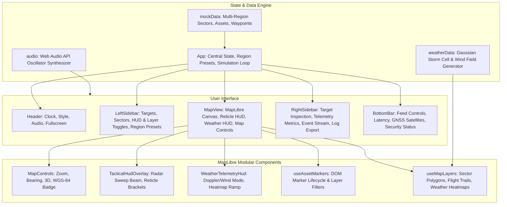

# GeoTactical Telemetry Monitor 🛰️🌾

> **Tactical Geospatial Surveillance & Precision Agri-Telemetry Console**  
> An autonomous operations dashboard combining military-grade command HUD aesthetics with precision agricultural telemetry, real-time drone and tractor tracking, IoT sensor networks, and simulated Doppler weather radar powered by **MapLibre GL**.

---

## ⚡ Core Features

- **100% Free & Keyless MapLibre GL GIS Infrastructure:**
  - Zero API keys, zero tokens, and zero usage limits required across all map layers.
  - Dynamic switching between 4 free & open basemaps:
    - **Tactical Dark (DARK):** OpenFreeMap Dark Vector (`tiles.openfreemap.org`) — ultra-crisp vector map designed for MapLibre with zero API keys or limits (replaces Carto).
    - **Satellite Recon (SATELLITE):** ESRI World Imagery — high-resolution photographic earth observation.
    - **Terrain Topo (TOPO):** ESRI World Topo — shaded relief and elevation contours for slope and watershed analysis.
    - **OpenStreetMap (OSM):** OpenStreetMap Standard — 100% open-source community cartography with complete land-use roads.
  - 3D pitch perspective camera control with bearing reset, zoom controls, and live WGS-84 coordinate reticle.
  - Interactive agricultural sector polygons with alert level outlines (Critical, Moderate, Optimal) and soil moisture percentages.
- **Multi-Region Agricultural Corridors:**
  - **Aegean Agri-Corridor (Turkey):** Durum wheat, Ayvalık olive groves, Sultana vineyards, and hybrid tomatoes in the Gediz Basin.
  - **San Joaquin Farmlands (California):** Almond orchards, pistachio groves, and pivot-irrigated alfalfa fields.
  - **Rhine Valley Terraces (Germany):** Steep-slope Riesling vineyards, Pinot Noir, and Black Forest hops.
- **Autonomous Asset Fleet Tracking:**
  - Real-time kinematic (RTK) tracking for UAV Recon Drones, Autonomous Tractors, IoT Soil Probes, and Smart Irrigation Hubs.
  - Waypoint trail visualization with glowing flight path trails and live heading vectors.
  - Action commands: RTH (Return to Base), Multispectral NDVI Canopy Sweep, Valve Pressure regulation, and RTK Beacon calibration.
- **Doppler Meteorology & Weather Radar:**
  - Live animated Doppler precipitation heatmap with customizable radar color ramps (0 to 45+ mm/h).
  - Wind speed velocity heatmaps and vector scatter points with dynamic storm heading.
  - Real-time atmospheric statistics: Peak rain cell, gust velocity, and storm cell direction.
- **Synthesized Web Audio Engine:**
  - Zero-external-dependency tactical sound effects generated via the **Web Audio API** (radar pings, target locks, alert buzzers, click feedback).
- **Tactical Sci-Fi HUD Overlays:**
  - 360° rotating radar sweep beam.
  - Reticle corners, crosshairs, and live coordinate tracking under the mouse cursor.

---

## 🏗️ Architecture



---

## 🚀 Quick Start

### Prerequisites
- [Node.js](https://nodejs.org/) v18+ (v20+ recommended)
- [npm](https://www.npmjs.com/) or [bun](https://bun.sh/)

### 1. Clone the repository
```bash
git clone https://github.com/mserman90/GeoTactical.git
cd GeoTactical
```

### 2. Install dependencies
```bash
npm install
```

### 3. Start development server
```bash
npm run dev
```
The console will be accessible at `http://localhost:3000`.

### 4. Build for production
```bash
npm run build
```
Optimized vendor chunks (`vendor-maplibre`, `vendor-react`, `vendor-icons`) will be generated into the `dist/` directory.

---

## ⚙️ Tech Stack

| Layer | Technologies |
| :--- | :--- |
| **Framework** | [React 19](https://react.dev/), [TypeScript 5.8](https://www.typescriptlang.org/), [Vite 6](https://vitejs.dev/) |
| **Styling** | [Tailwind CSS v4](https://tailwindcss.com/) with `@tailwindcss/vite` |
| **GIS & 3D Maps** | [MapLibre GL v6](https://maplibre.org/) |
| **Icons** | [Lucide React](https://lucide.dev/) |
| **Audio** | Native HTML5 Web Audio API (OscillatorNode & GainNode) |

---

## 🗺️ Roadmap & Implemented Capabilities

- [x] **Modular Map Architecture:** Separated MapView into dedicated hooks (`useMapLayers`, `useAssetMarkers`) and HUD overlay components.
- [x] **Vite Bundle Optimization:** Custom chunk splitting separating MapLibre, React, and Lucide (`vendor-maplibre`, `vendor-react`, `vendor-icons`), reducing main bundle by 80%.
- [x] **Multi-Region Synchronization:** Real-time data loading for Aegean, California, and Rhine corridors.
- [x] **100% Free & Keyless Tactical AI:** Zero-auth, keyless neural model endpoint (Pollinations.ai) backed by an offline-capable local tactical agri-reasoning engine for real-time anomaly diagnostics and natural language command execution with **no API keys, tokens, or sign-ups required**.
- [x] **Camera Chase Mode:** Automatic tactical camera locking (`Chase Cam`) smoothly tracking active drones/tractors during flight.
- [x] **Interactive Waypoint Mission Planner:** Click-to-draw flight corridors on the map with live distance/flight time calculation and direct deployment to UAVs.
- [x] **GeoJSON Parcel Export:** Real-time export of agricultural parcel boundaries and metrics as standard GeoJSON.
- [x] **Synthesized Voice Annunciator:** Tactical speech synthesis (`speakAlert`) using the Web Speech API.

---

## 📜 License
MIT License. Created by [mserman90](https://github.com/mserman90).
